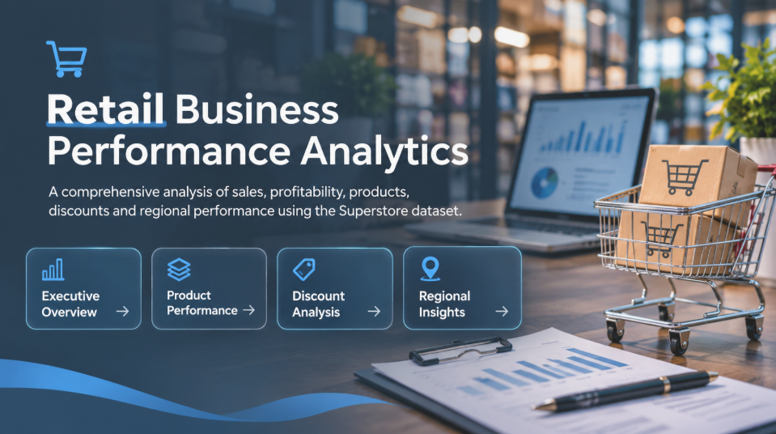
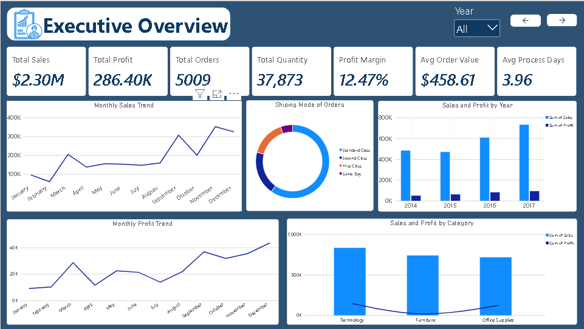
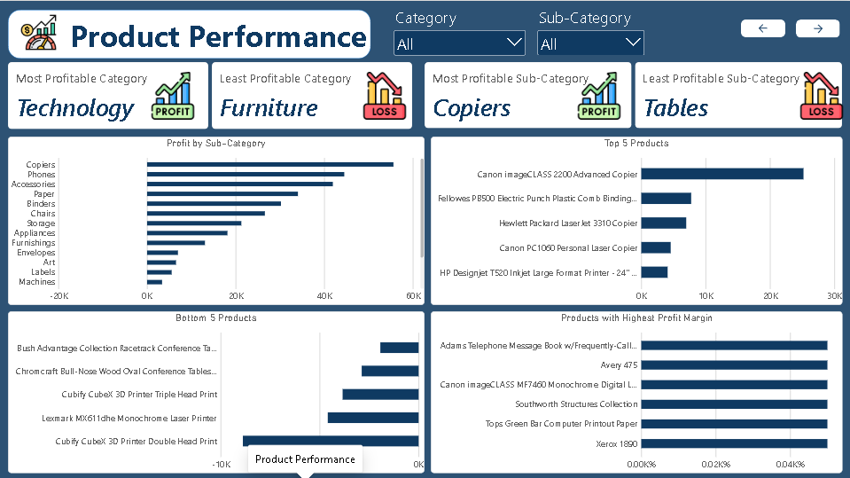
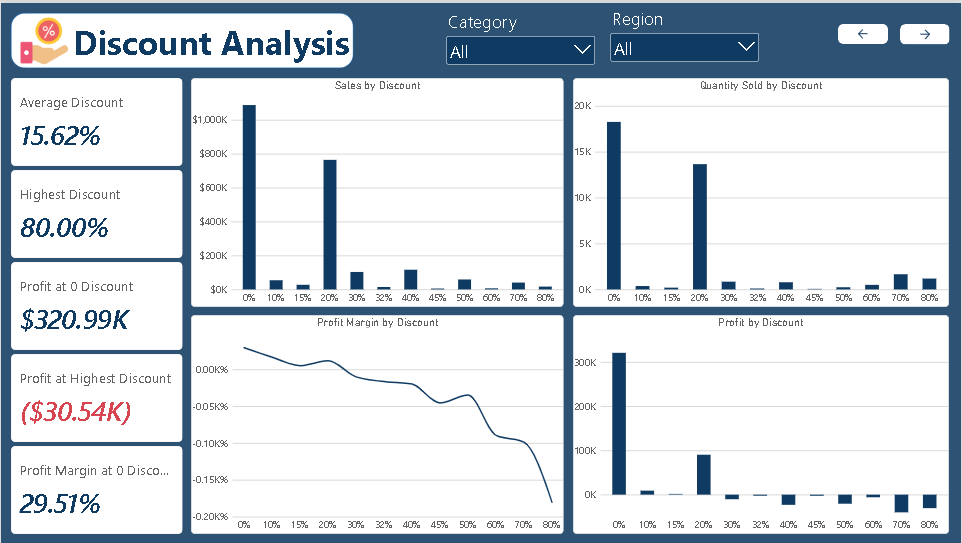
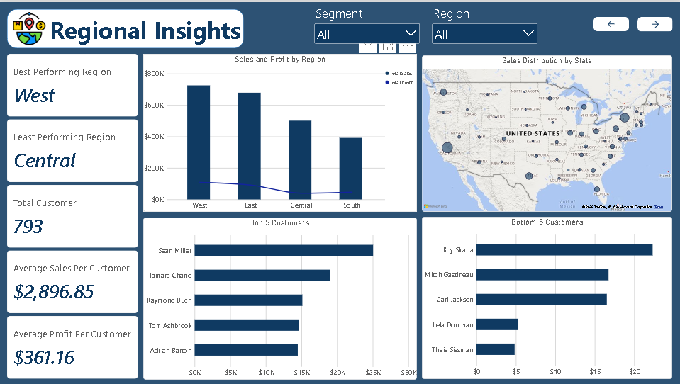

# Superstore Sales & Financial Analytics

An end-to-end data analytics project that explores retail sales, profitability, discount strategies, regional performance, and customer behavior using Python and Microsoft Power BI.

## Project Overview

The objective of this project is to analyze the Superstore dataset and transform raw retail data into meaningful business insights through data analysis and interactive visualizations.

The project follows an end-to-end analytics workflow, starting with data exploration and cleaning using Python, followed by the development of a five-page interactive Power BI dashboard.

The dashboard helps understand business performance, identify profitable products and categories, evaluate discount strategies, compare regional performance, and analyze customer contributions.

## Project Objectives

- Analyze overall sales, profit, orders, and quantity.
- Evaluate category and subcategory profitability.
- Identify top-performing and underperforming products.
- Understand the relationship between discounts, sales, and profit.
- Compare regional and state-level sales performance.
- Analyze customer contributions and purchasing behavior.
- Develop an interactive dashboard to support data-driven decision-making.

## Tools & Technologies

| Technology | Purpose |
|---|---|
| Python | Data exploration and cleaning |
| Pandas | Data manipulation and preprocessing |
| Jupyter Notebook | Data analysis workflow |
| Microsoft Power BI | Dashboard development and visualization |
| DAX | Measures and business calculations |

## Project Workflow

1. **Data Collection:** Acquired the Superstore sales dataset.
2. **Data Exploration:** Examined the dataset to understand its structure and identify data quality issues.
3. **Data Cleaning:** Used Python and Pandas for data cleaning and preprocessing.
4. **Data Preparation:** Prepared the cleaned dataset for Power BI.
5. **Data Modeling & Calculations:** Created DAX measures for business KPIs and financial metrics.
6. **Dashboard Development:** Designed a five-page interactive Power BI report.
7. **Business Analysis:** Analyzed sales, profitability, discounts, regions, and customer performance.

## Power BI Dashboard

The dashboard contains five interconnected analytical pages.

### 1. Home

- Project introduction and overview.
- Interactive navigation to different analytical pages.

### 2. Executive Financial Overview

Provides a high-level overview of the business's financial performance.

**Key Performance Indicators:**
- Total Sales
- Total Profit
- Total Orders
- Total Quantity
- Profit Margin
- Average Order Value
- Average Processing Days

**Visualizations:**
- Monthly Sales Trend
- Monthly Profit Trend
- Annual Sales & Profit
- Sales & Profit by Category
- Shipping Mode Distribution

### 3. Profitability & Product Performance

Focuses on identifying profitable and underperforming products and categories.

**Key Performance Indicators:**
- Most Profitable Category
- Least Profitable Category
- Most Profitable Subcategory
- Least Profitable Subcategory

**Visualizations:**
- Profit by Subcategory
- Top 5 Products by Profit
- Bottom 5 Products by Profit
- Products with the Highest Profit Margins

### 4. Discount & Sales Analysis

Examines how different discount levels affect sales, profit, and quantity sold.

**Key Performance Indicators:**
- Average Discount
- Highest Discount
- Profit at 0% Discount
- Profit at Highest Discount
- Profit Margin at 0% Discount

**Visualizations:**
- Sales by Discount Level
- Profit by Discount Level
- Profit Margin by Discount Level
- Quantity Sold by Discount Level

### 5. Regional & Customer Insights

Analyzes regional business performance and customer contributions.

**Key Performance Indicators:**
- Best Performing Region
- Lowest Performing Region
- Total Customers
- Average Sales per Customer
- Average Profit per Customer

**Visualizations:**
- Sales & Profit by Region
- Sales Distribution by State
- Top 5 Customers by Sales
- Bottom 5 Customers by Sales

## Dashboard Previews

### 1. Home


### 2. Executive Financial Overview


### 3. Profitability & Product Performance


### 4. Discount & Sales Analysis


### 5. Regional & Customer Insights


## Key Business Insights

The analysis revealed several important business insights:

- **Annual Sales Performance:** 2017 recorded the highest annual sales during the analyzed period.
- **Category Performance:** Technology was the most profitable category.
- **Subcategory Performance:** Copiers generated the highest profit, while Tables had the lowest profit.
- **Discount Analysis:** Higher discounts did not necessarily result in higher sales. Discount levels above 30% were associated with losses.
- **Quantity Analysis:** Products with 0% discounts recorded the highest quantity sold, followed by products with 20% discounts.
- **Regional Performance:** The West region recorded the highest sales and profit, while the Central region had the lowest profit margin.
- **Customer Analysis:** The dashboard identifies the top five and bottom five customers based on sales contribution.

## Repository Structure

```text
Superstore-Sales-and-Financial-Analytics/
│
├── README.md
│
├── data/
│   ├── Original Dataset
│   └── Cleaned Dataset
│
├── notebooks/
│   └── Data_inspection.ipynb
│
├── powerbi/
│   ├── assets/
│   │   └── KPI Images
│   │
│   └── Superstore_Dashboard.pbix
│
└── screenshots/
    ├── Home.png
    ├── Executive_Overview.png
    ├── Product_performance.png
    ├── Discount_Analysis.png
    └── Regional_Insights.png
```

## How to Run the Project

To explore the project:

1. Clone or download this repository.
2. Install Python and the required libraries, including Pandas and Jupyter Notebook.
3. Open the notebook in Jupyter Notebook to explore the data preparation process.
4. Open `Superstore_Dashboard.pbix` using Microsoft Power BI Desktop.
5. Explore the five dashboard pages and interact with the available slicers.

## Project Outcome

This project demonstrates the practical application of data analytics skills, including data cleaning, data manipulation, business analysis, DAX calculations, and interactive dashboard development.

It showcases how raw retail data can be transformed into meaningful insights that help businesses understand performance and make informed decisions.

---

**Author:** Rishav Jangra

**Project:** Superstore Sales & Financial Analytics
